# Bingr voor Android

[](https://github.com/LRvdLinden/bingr-android/actions/workflows/build.yml)
[](https://github.com/LRvdLinden/bingr-android/releases/latest)

Native IPTV- en mediaspeler voor **Android-telefoon, tablet en Android TV / Google TV / Fire TV** met de look & feel van Netflix.
Kotlin · Jetpack Compose · Android 7.0+ · Media3 (ExoPlayer) én VLC · 11 talen · versie 1.0.0 (build 45).

De versie voor iPhone, iPad, Apple TV en Mac staat in [iptv-ios-appletv](https://github.com/LRvdLinden/iptv-ios-appletv), de website in [bingr-website](https://github.com/LRvdLinden/bingr-website) ([bingr.online](https://bingr.online)).

Wat er nieuw is per build: [CHANGELOG.md](CHANGELOG.md) · [bingr.online/changelog](https://bingr.online/changelog/?p=android)

## Downloaden

**[⬇ Download de nieuwste APK](https://github.com/LRvdLinden/bingr-android/releases/latest)**: tik onder *Assets* op `Bingr-…apk`, open hem en kies **Installeren**. Android vraagt één keer of de app waarmee je opent (Chrome, Bestanden, WhatsApp …) apps mag installeren: zet *Toestaan van deze bron* aan. Een nieuwe versie installeer je gewoon over de oude heen; je profielen en instellingen blijven bewaard.

Op **Android TV / Google TV / Fire TV**: installeer de app *Downloader*, sta onbekende bronnen toe en open daarin de link hierboven.

## Screenshots

> Ontwerp-previews van de schermen (gerenderd vanuit de mockups in de iOS-repo met `tools/make_screenshots.py --android`, met fictieve titels en zenders en echte posters van TMDB). Worden vervangen door echte screenshots van de app.

### Telefoon & tablet

| Splash | Wie kijkt er? | Home |
|:---:|:---:|:---:|
| 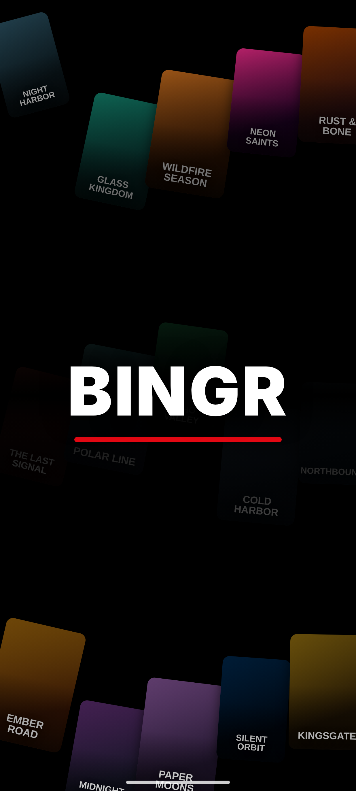 | 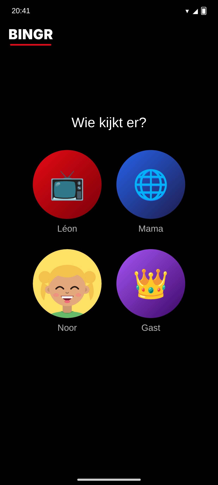 | 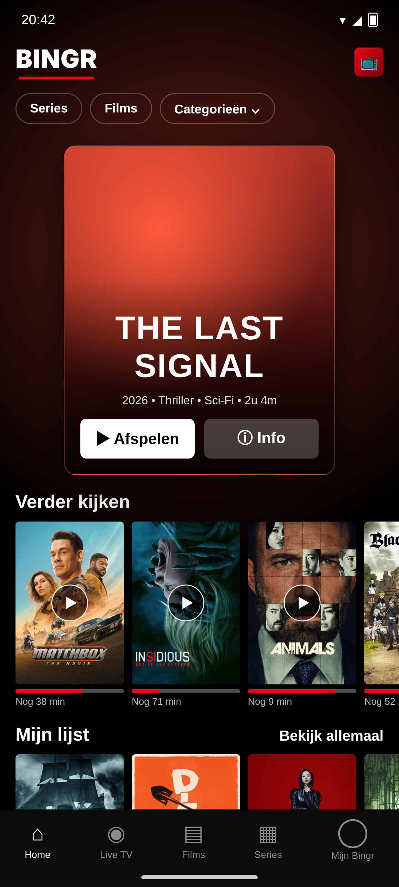 |
| **Details** | **Details: scores, cast, aanbevelingen** | **Live TV** |
| 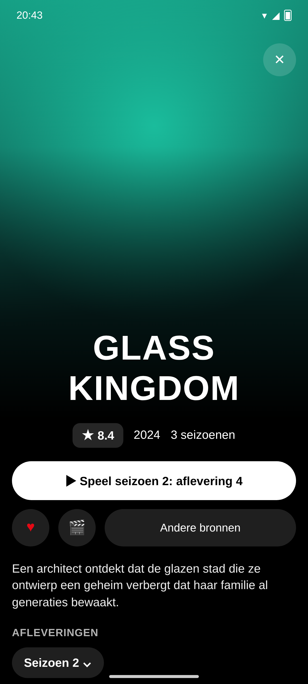 | 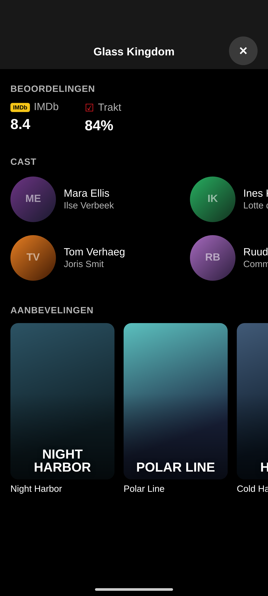 | 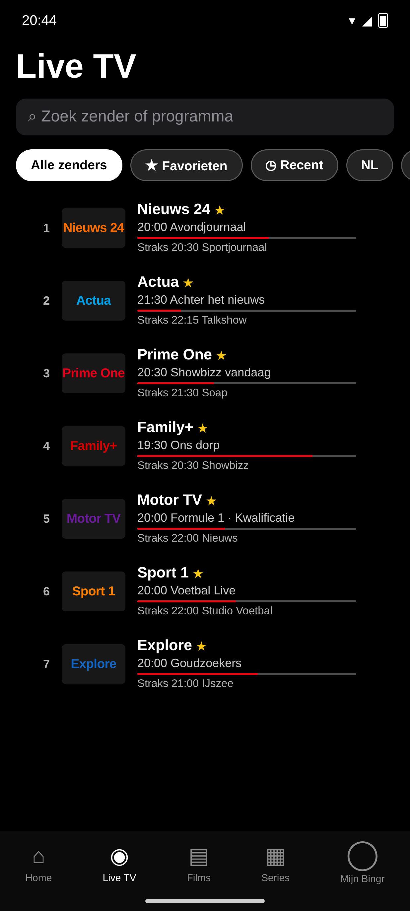 |
| **Tv-gids** | **Top 10** | **Bekijk allemaal** |
| 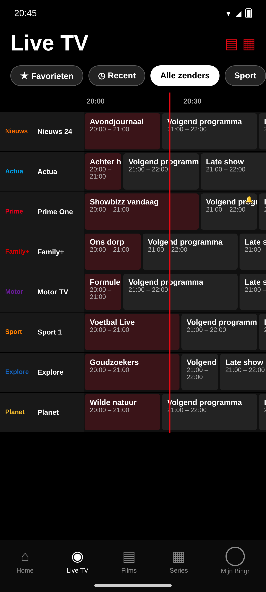 | 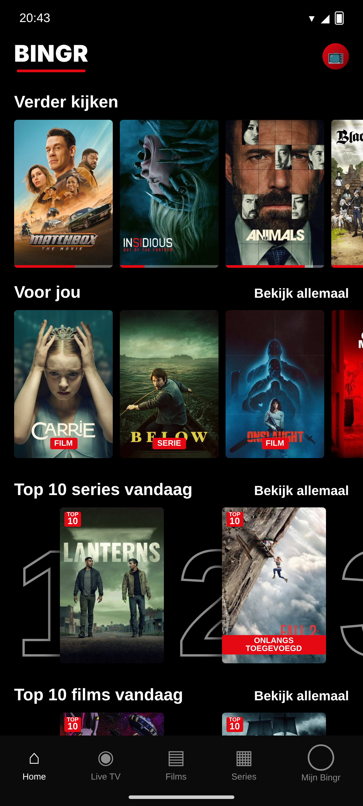 | 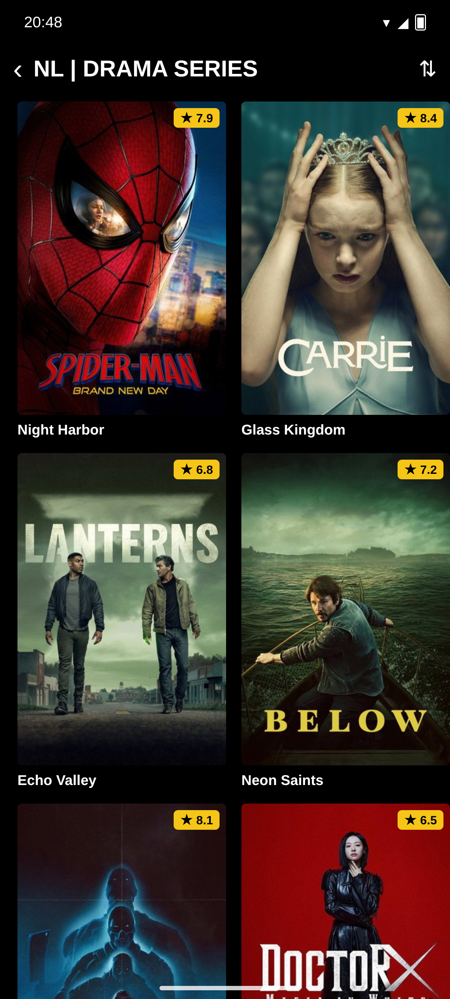 |
| **Server toevoegen** | **Mijn Bingr** | **Categorieën aan/uit** |
| 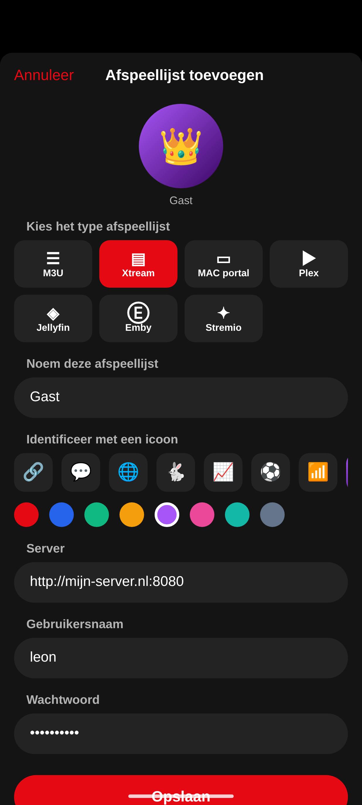 | 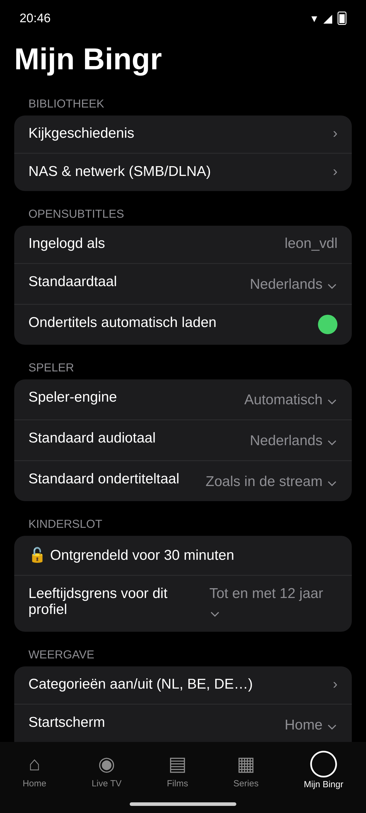 | 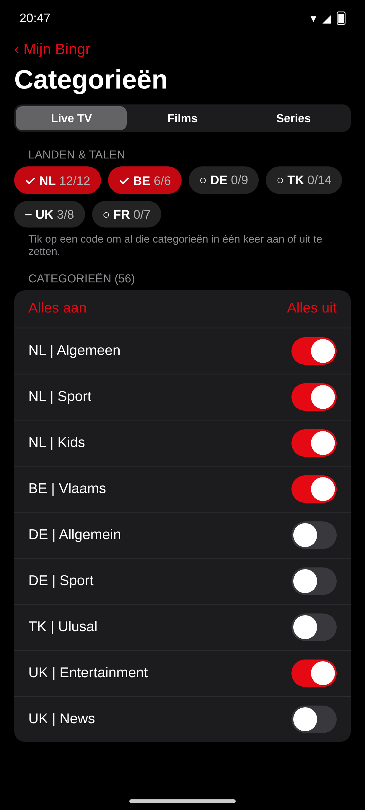 |

### Android TV / Google TV / Fire TV

| Home | Wie kijkt er? |
|:---:|:---:|
| 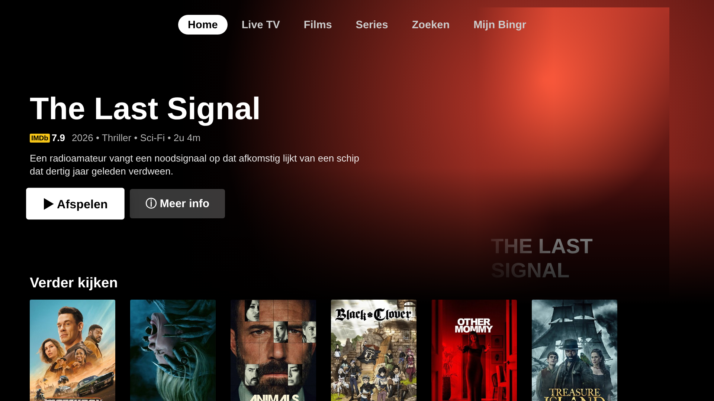 | 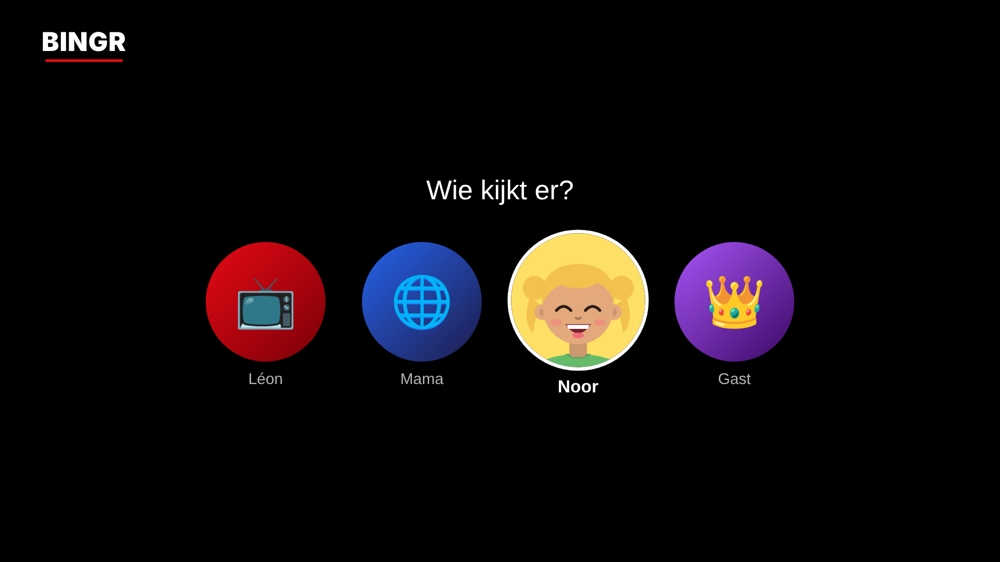 |
| **Serie + afleveringen** | **Live TV** |
| 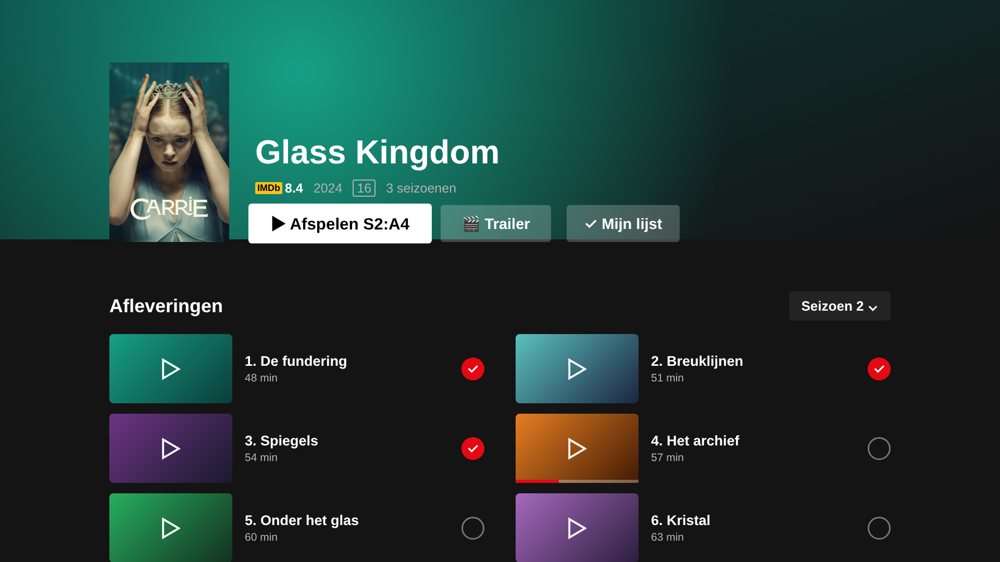 | 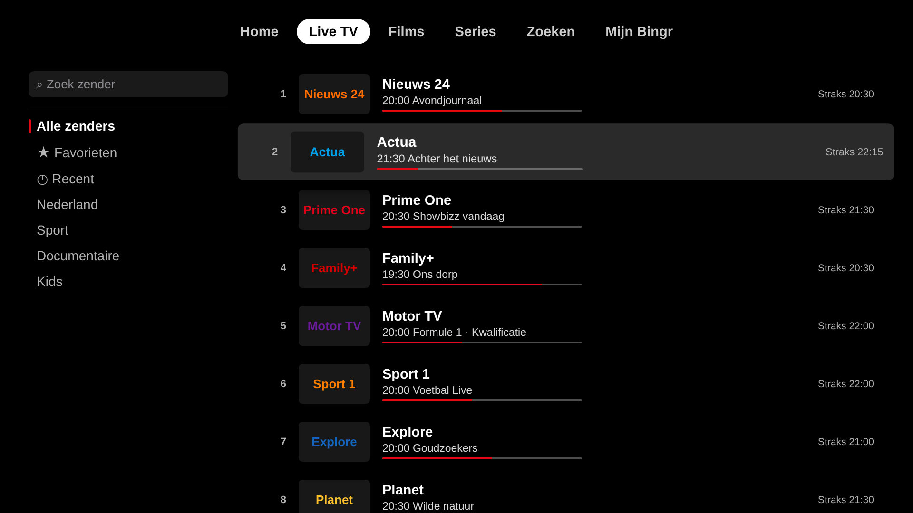 |
| **Tv-gids** | **Multiview** |
| 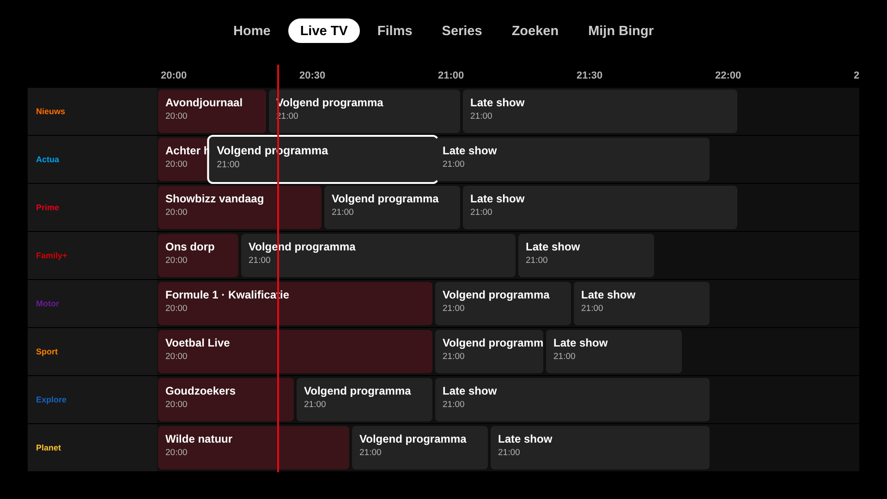 | 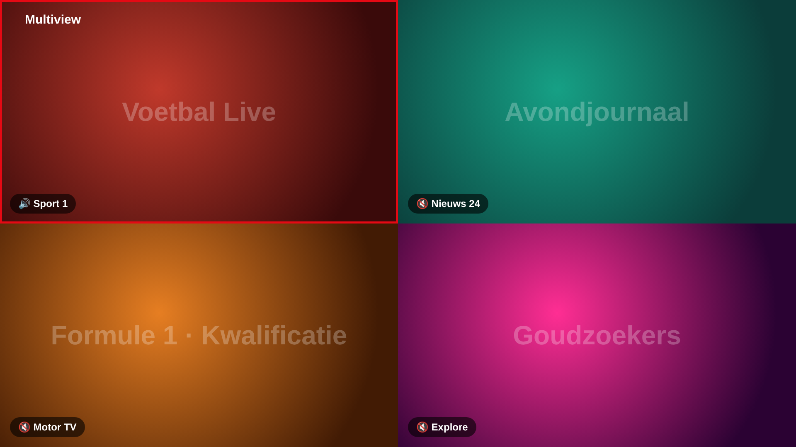 |
| **Trakt koppelen** | |
| 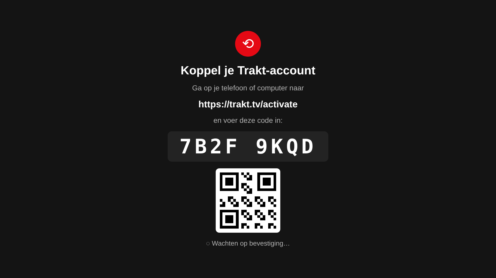 | |

Engelse versies van alle screenshots staan in [`docs/screenshots/en`](docs/screenshots/en).

## Functies

**Account**
- **Bingr-account verplicht** (zoals Netflix): na de splash inloggen of een account maken, daarna "Wie kijkt er?"
- Inloggen met e-mail en wachtwoord, **wachtwoord vergeten** via bingr.online/reset
- **Android TV / Fire TV**: inloggen met je telefoon via **QR-code** of een code op **bingr.online/tv**, of met e-mail
- **Tv koppelen** vanaf je telefoon of tablet (*Mijn Bingr → Account → Link a TV*), **uitloggen** en **account verwijderen**
- **Profielen in je account**: bij de eerste login worden je bestaande profielen aan je account gekoppeld en gedeeld met iPhone, iPad, Apple TV en Mac (naam, avatar, kinderprofiel). Eigen profielfoto's worden via je Bingr-account gedeeld met al je apparaten (ook iPhone/iPad/Apple TV/Mac)
- **Profielen (toevoegen, wijzigen, verwijderen) synchroniseren met al je apparaten**
- **Servers en afspeellijsten worden versleuteld bij je account bewaard**, dus na updaten of opnieuw installeren staat alles weer klaar
- **Trakt en OpenSubtitles: gewoon inloggen**, de sleutels komen veilig van de Bingr-server
- **Alles (Trakt, OpenSubtitles, instellingen, Mijn lijst, voortgang, bekeken, pincodes, herinneringen) gaat versleuteld mee met je account**: na opnieuw installeren of op een nieuw apparaat staat alles na het inloggen weer klaar
- De sessie staat alleen op dit apparaat. Logt een ander account in, dan worden de servers, profielen en gegevens van het vorige account eerst van het apparaat gewist
- **Max. 10 apparaten** per account: zit je aan de limiet, dan verwijder je bij het inloggen eerst een apparaat (*Too many devices*). Beheer al je apparaten via *Mijn Bingr → Account → Devices* (ook op tv); een verwijderd apparaat wordt **automatisch uitgelogd**
- **Apparaten hernoemen**: geef elk gekoppeld apparaat (ook dit apparaat) een eigen naam via *Mijn Bingr → Account → Devices → Rename*, ook op tv met het tv-toetsenbord en op bingr.online/account. Android-telefoon, -tablet, Android TV, **Google TV** en Fire TV worden elk als eigen apparaattype herkend

**Bronnen**
- M3U/M3U8 + XMLTV-EPG, **Xtream Codes** (incl. catch-up), **Stalker/MAC-portal**
- **Plex**, **Jellyfin**, **Emby** (films, series, live TV + gids) en **Stremio** (add-on-URL's, Cinemeta-catalogi)
- **NAS via SMB/DLNA**: servers op je netwerk vinden en afspelen
- **Eén hoofdaccount, meerdere profielen**: het hoofdaccount stelt de server, Trakt, OpenSubtitles, kinderslot en categorieën in en maakt profielen aan. Elk profiel heeft **volledig eigen gegevens**: Mijn lijst, Verder kijken, favorieten, bekeken en kijkgeschiedenis. Eigen naam, avatar (icoon, een van 16 getekende figuurtjes of een eigen foto) en eigen **pincode**
- **Zoeken in al je afspeellijsten** tegelijk: films, series, zenders en categorieën

**Kijken**
- Twee engines: **Media3/ExoPlayer** voor HLS/DASH/MP4 en **VLC** voor .ts, .mkv, AC3/DTS en de rest; automatisch kiezen of zelf instellen
- **Chromecast** en **beeld-in-beeld**
- **Standaard audio- en ondertiteltaal**, automatisch herverbinden bij haperende streams, duidelijke melding met "Opnieuw" als een stream niet werkt
- **Volgende aflevering**: knop aan het eind en automatisch door naar de volgende (ook over seizoenen heen)
- **Timeshift** op live tv (pauzeren en terugspoelen via catch-up)
- **Multiview**: tot 4 streams tegelijk
- **Ondertitelgrootte** (klein, middel, groot), audio- en ondertitelsporen, **OpenSubtitles** (zoeken op IMDb-ID of titel, taal kiezen tijdens het kijken), snelheid, beeldverhouding, slaaptimer, zappen
- **Android TV-bediening** met de afstandsbediening: OK = bediening, ←/→ = 10 s spoelen, ↑/↓ = zappen

**Gids & beheer**
- **Tv-gids als raster** met nu-lijn, programma-details, **terugkijken** en **herinneringen** (melding)
- **Live TV** met favorieten, recent en alle groepen, en **zoeken door álle zenders** (naam, nummer, groep en wat er nu speelt)
- **Categorieën aan/uit** per Live TV, Films en Series, met snelknoppen per land/taal
- **Beheren**: groepen en zenders hernoemen, herschikken en verbergen
- **Pincode** per profiel en kinderslot: groepen op slot, volwassenengroepen automatisch, **leeftijdsgrens per profiel**, 30 min ontgrendelen
- **Kinderprofiel**: alleen kinderzenders, tekenfilms/familie en titels binnen de leeftijdsgrens, met een eigen **Top 10 voor kids**
- **Gezien per profiel, ook zonder Trakt**: vinkjes op films en afleveringen
- **Kijkgeschiedenis per profiel**

**Detailpagina**
- Grote afbeelding met titel, score, jaar en speelduur/seizoenen
- Eén knop "Speel seizoen 2: aflevering 4" (gaat verder waar je was), Mijn lijst, trailer, afvinken
- **Delen** via WhatsApp, Instagram, Facebook, Mail … met een link naar IMDb (of Trakt/TMDB), op telefoon en tablet (niet op tv)
- Afleveringen met foto, voortgang en vinkje; beoordelingen (IMDb, Trakt, TMDB), cast en aanbevelingen

**Netflix-ervaring**
- Splash met de Bingr-intro, profielkeuze met ronde avatars, billboard en rijen
- **Top 10** (trending via TMDB en Trakt, gekoppeld aan jouw lijst)
- **Verder kijken** met voortgangsbalk; aantikken geeft **Hervatten** of **Opnieuw kijken**
- **Mijn lijst** per profiel, bij het hoofdaccount samen met de Trakt-watchlist
- **Trakt, 2 kanten op** (hoofdaccount): koppelcode + QR, gezien-vinkjes uit Trakt, afvinken naar Trakt, scrobblen en watchlist
- **11 talen**: Engels, Nederlands, Duits, Frans, Spaans, Italiaans, Portugees, Turks, Pools, Arabisch en Chinees (gedeeld met de iOS-app)

## Bouwen

1. Open deze map in **Android Studio** (*File → Open*). Gradle 8.10.2, AGP 8.7.3, Kotlin 2.1, JDK 17.
2. Zet je sleutels in `local.properties` (staat niet in git):
   ```
   TRAKT_CLIENT_ID=...
   TMDB_API_KEY=...
   OMDB_API_KEY=...
   OPENSUBTITLES_API_KEY=...
   SUPABASE_URL=https://xxxx.supabase.co
   SUPABASE_ANON_KEY=...
   # TRAKT_CLIENT_SECRET=...   (optioneel: Trakt-koppeling werkt met PKCE zonder secret)
   # TMDB_ACCESS_TOKEN=...     (in plaats van TMDB_API_KEY)
   ```
   Zonder sleutels werkt de app ook: na het inloggen haalt de app de Trakt-, OpenSubtitles-, OMDb- en TMDB-sleutels op bij de Bingr-server. Eigen sleutels kun je nog invullen via *Mijn Bingr → Koppelingen instellen* (onderaan). `SUPABASE_URL` en `SUPABASE_ANON_KEY` (Bingr-account) worden alleen ingebouwd; zonder deze twee toont het inlogscherm "Continue without account".
3. *Build → Build App Bundle(s) / APK(s) → Build APK(s)*, of druk op ▶ voor een toestel of Android TV-emulator.

**Ondertekening:** de CI tekent elke APK met dezelfde vaste sleutel (secrets `BINGR_KEYSTORE_BASE64` en `BINGR_KEYSTORE_PASSWORD`), zodat je een nieuwe versie gewoon over de oude heen installeert en alles bewaard blijft. Lokaal stel je een sleutel in met `BINGR_KEYSTORE`, `BINGR_KEYSTORE_PASSWORD`, `BINGR_KEY_ALIAS` en `BINGR_KEY_PASSWORD` in `local.properties` (of als secrets); zonder sleutel wordt met de debug-sleutel getekend.

**Automatisch bouwen:** de workflow `Build` bouwt bij elke push naar `main` een APK en zet die bij [Releases](https://github.com/LRvdLinden/bingr-android/releases) (`v1.0.0-build38`). Zet de sleutels (ook `SUPABASE_URL` en `SUPABASE_ANON_KEY`) als repository-secrets bij *Settings → Secrets and variables → Actions*. Het build-log staat op de branch `ci-logs`.

Versie blijft 1.0.0; het buildnummer (`BINGR_BUILD` in `gradle.properties`) loopt gelijk met de iOS-app.

## Vertalingen

Alle teksten staan in de code in het Engels (`L("Play")`) en worden vertaald via `app/src/main/assets/Translations.json`, een kopie van `Shared/Resources/Translations.json` uit de iOS-repo.

## Structuur

```
app/src/main/java/nl/lrvdlinden/bingr/
  core/        app-start, AppState, profielen en opslag (Store), instellingen, sleutels, taalsysteem (L())
  providers/   M3U, XMLTV, Xtream, Stalker, Plex, Jellyfin/Emby, Stremio + cache
  meta/        IMDb (OMDb), TMDB, titels opschonen en koppelen, trending
  trakt/       login, sync, scrobble, watchlist
  subs/        OpenSubtitles
  player/      ExoPlayer/VLC-engines, Chromecast, multiview, panelen, ondertitels
  parental/    pincode, kinderslot, herinneringen
  ui/          Netflix-thema, kaarten, schermen (profielen, home, live, gids, detail, categorie, beheren, zoeken, instellingen)
app/src/main/res/      iconen, profielfiguurtjes (drawable-nodpi/kid01–16)
app/src/main/assets/   Translations.json
docs/screenshots/      screenshots (NL en en/)
CONTRACT.md            opzet van de code
```

## Opmerking

Bingr is een speler: je gebruikt je eigen, legale afspeellijsten en mediaservers.
